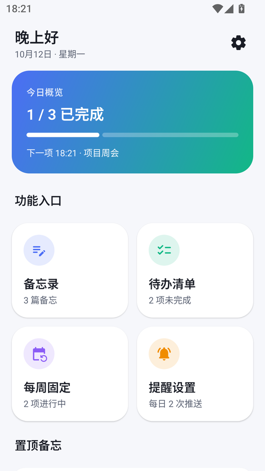
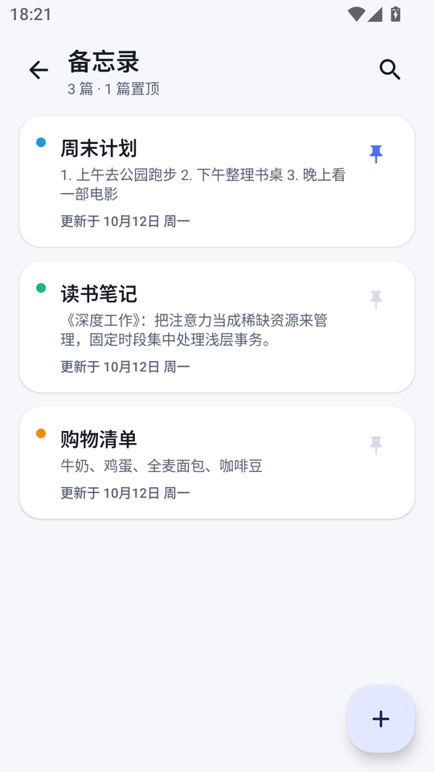
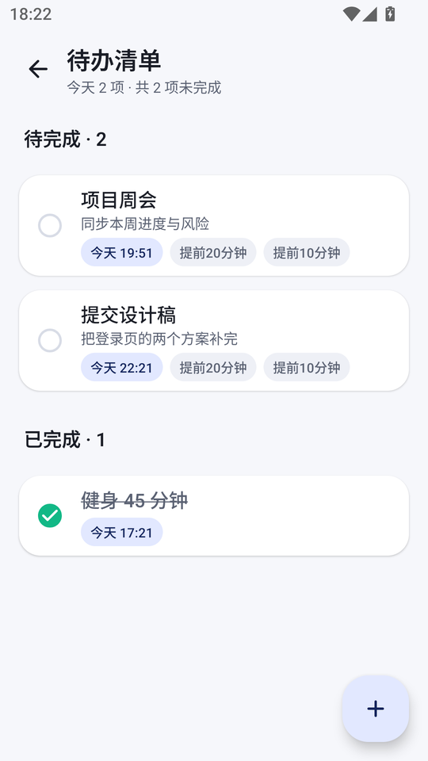
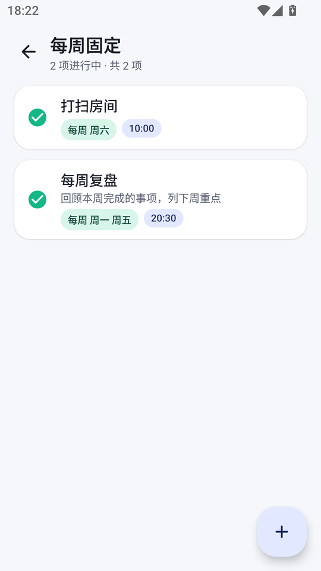
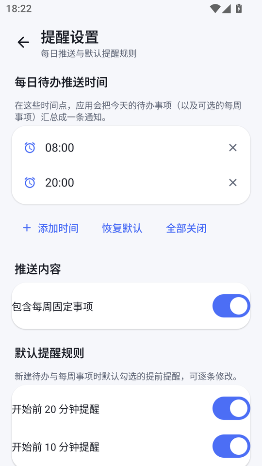
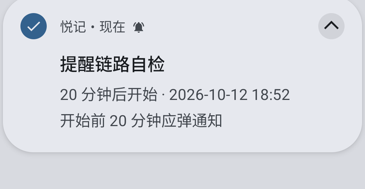
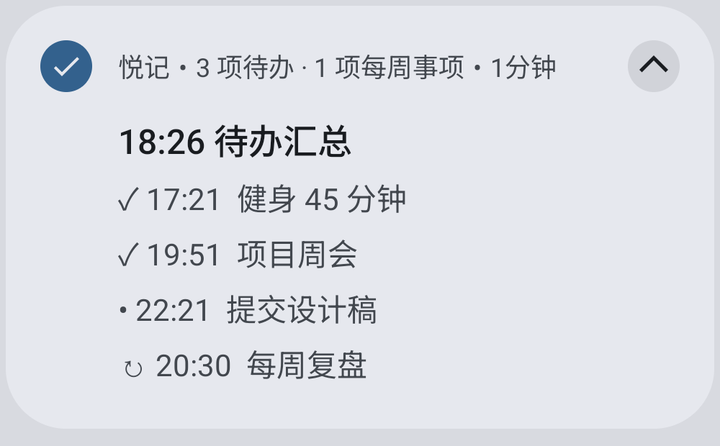
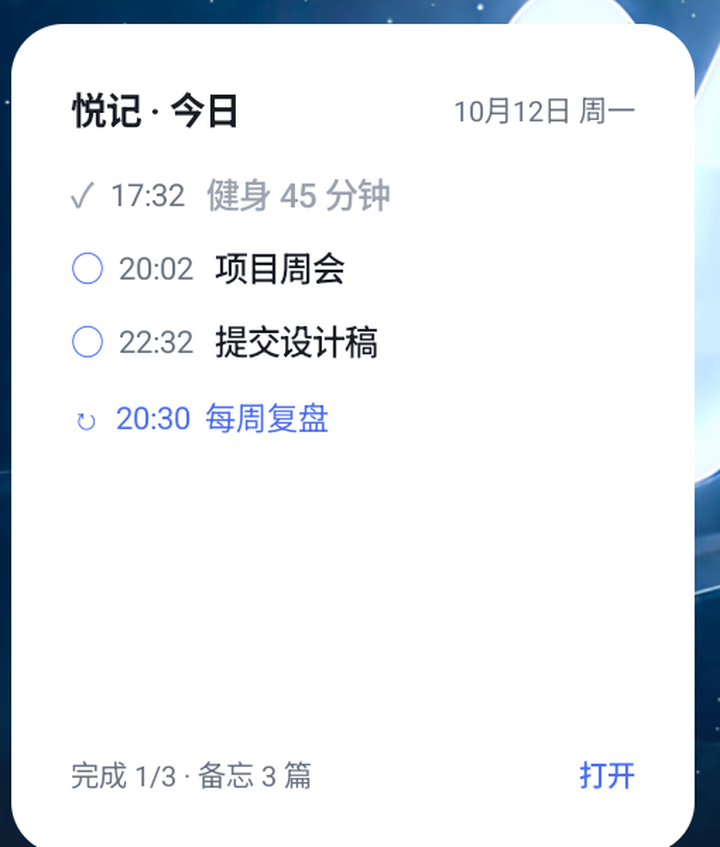

# 悦记 · YueJi

> 一个完全离线的 Android 备忘录应用：备忘录 + 待办清单 + 每周固定事项 + 桌面小组件，
> 在待办开始前 20 分钟和 10 分钟各提醒一次，并在你自选的时间点推送「今日待办」汇总。

-3DDC84?logo=android&logoColor=white)


界面语言为简体中文。

<p align="center">
  
  
  
  
  
</p>

---

## 主要功能

### 1. 开始菜单：一屏看清今天

打开应用就是「开始菜单」：顶部按当前时间问候，下面依次是**今日概览卡**（今日完成进度条 +
即将到来的一项待办）、**2×2 功能入口**（备忘录 / 待办清单 / 每周固定 / 提醒设置）、
**置顶备忘**、**今日待办**和**今日每周事项**。所有入口都在首屏，不用翻菜单。

### 2. 备忘录

- 标题 + 正文，新建 / 编辑 / 删除
- 6 种颜色标记（默认、沙、薄荷、天蓝、丁香、玫瑰），列表里以色点区分
- 置顶：置顶的备忘录始终排在前面
- 关键字搜索，实时过滤标题与正文
- 列表显示内容预览与「更新于 …」

### 3. 待办清单 —— 开始前 20 分钟、10 分钟各提醒一次

- 待办包含标题、备注、以及**精确到分钟的日期 + 时间**
- 新建时可用「今天 / 明天 / 后天 / 一周后」快捷选日期，也可以用日期选择器和时间选择器
- 每条待办可以**分别**开关「开始前 20 分钟提醒」和「开始前 10 分钟提醒」
- 列表按「待完成 / 已完成」分区，点击圆圈即可勾选，已完成项加删除线
- 提醒用 `AlarmManager` 的**精确闹钟**下发，落在分钟上而不是「大约那个时间」

<p align="center">
  
</p>

### 4. 每周固定事项

- 一周里可以选**任意多天**（周一 ~ 周日），加上一个时间点，例如「每周一、周五 20:30 复盘」
- 提供「每天 / 工作日 / 周末」快捷选择
- 每条可以启用 / 停用，同样支持开始前 20 / 10 分钟提醒
- 触发后自动顺延到下一个匹配的星期，无需手动维护
- 首页只显示今天会发生的每周事项

### 5. 每日待办汇总推送 —— 时间点由你决定

- 在「提醒设置」里**自行添加一个或多个时间点**（最多 8 个），到点推送一条汇总通知
- 通知用 InboxStyle 展开，逐条列出当天未完成的待办，并可选择是否附带今日的每周事项
- 一键「恢复默认」（08:00、20:00）或「全部关闭」
- 每个时间点都是独立的精确闹钟，触发后自动排到明天的同一时刻

<p align="center">
  
</p>

### 6. 桌面小组件

- 显示今天的待办（含时间与完成状态）、完成进度、今天的每周事项、备忘数量
- **可以直接在小组件上勾选完成**，列表和进度条会同步刷新
- 点标题可以打开应用；小组件尺寸自适应，可自由缩放

<p align="center">
  
</p>

### 7. 其他

- **完全离线**：应用不申请 `INTERNET` 权限，数据只写在应用私有目录的 JSON 文件里
- 跟随系统 / 浅色 / 深色三种主题，暗色是单独调过的配色
- 开机、时间或时区变更、应用升级之后自动重排全部闹钟
- 「提醒设置」里有「发送一条测试通知」，方便确认通知链路是通的

---

## 下载与安装

到 [Releases](../../releases) 页面下载最新的 `YueJi-<版本>-release.apk`，传到手机上点击安装即可
（需要在系统设置里允许「安装未知来源应用」）。

首次进入请允许**通知**权限，并在「提醒设置」里确认**精确闹钟**已授权；
Android 12 及以上若未授权精确闹钟，提醒会被系统降级为不精确闹钟。

添加桌面小组件：长按桌面空白处 → 「微件 / 小组件」→ 找到「悦记」→ 拖到桌面。

---

## 从源码构建

需要 JDK 17+ 与 Android SDK（`platforms;android-35`、`build-tools;35.0.0`）。

```bash
git clone https://github.com/Miyuki5887/user_todo_list_Yue.git
cd user_todo_list_Yue

# 指向你自己的 Android SDK
echo "sdk.dir=/path/to/Android/Sdk" > local.properties

./gradlew assembleDebug      # 调试包
./gradlew assembleRelease    # 发布包
```

产物在 `app/build/outputs/apk/`。

### 关于签名

`app/build.gradle.kts` 会读取仓库根目录的 `keystore.properties`：

```properties
storeFile=keystore/yueji-release.jks
storePassword=******
keyAlias=yueji
keyPassword=******
```

**仓库里没有提交任何签名密钥**（`keystore.properties`、`keystore/`、`*.jks` 都在 `.gitignore` 里）。
没有这个文件时 release 包照样能编译，只是不带签名。要出自己签名的包：

```bash
bash tools/make-keystore.sh          # 生成密钥库与 keystore.properties
```

脚本里的口令只是占位默认值，正式发布前请用环境变量覆盖：
`YUEJI_STOREPASS` / `YUEJI_KEYPASS` / `YUEJI_KEYALIAS` / `YUEJI_DNAME`。

---

## 技术栈

| 层面 | 选择 |
| --- | --- |
| 语言 / UI | Kotlin 2.0.21 + Jetpack Compose + Material 3（Compose BOM 2024.10.01） |
| 导航 | Navigation Compose 2.8.4，单 Activity |
| 桌面小组件 | Glance AppWidget 1.1.1 |
| 持久化 | 系统内置 `org.json` 写 `filesDir`，暴露为 `StateFlow`（**没有引入 Room / KSP / kotlinx.serialization**） |
| 设置 | `SharedPreferences` + `StateFlow` |
| 提醒 | `AlarmManager` 精确闹钟 + `BroadcastReceiver`（**没有引入 WorkManager**） |
| 构建 | AGP 8.7.3 / Gradle 8.11.1 / compileSdk 35 / minSdk 26 |

### 为什么不用 Room 和 WorkManager

- 数据量很小（一个清单应用而已），`org.json` 足够；这样整条构建链**没有注解处理器和编译器插件**，
  在干净环境里更容易复现构建。
- `setRepeating` 从 API 19 起就不精确了，与其引入 WorkManager，不如直接用一次性精确闹钟，
  触发后由接收器重新武装下一次 —— 依赖更少，时间也更准。

### 两个容易踩的坑（已记录在代码注释里）

- `NotificationCompat.Style` 自带一个成员方法 `apply(...)`，会**遮蔽 Kotlin 的 `apply {}` 作用域函数**，
  所以 `InboxStyle().apply { ... }` 编译不过，必须改成命令式构造。
- Glance 1.1.1 里 `actionStartActivity<T>()` 这个 reified 重载并不存在，日/夜 `ColorProvider`
  也在 `androidx.glance.color` 而不是 `androidx.glance.unit`。

---

## 项目结构

```
app/src/main/java/com/yueji/memo/
├── YueJiApp.kt              # Application：初始化、建通知通道、注入两个 Bridge
├── MainActivity.kt          # 唯一的 Activity，处理通知跳转与通知权限申请
├── AppActions.kt            # 所有写操作：落库 + 重排闹钟 + 刷新小组件，三者同步
├── data/
│   ├── Models.kt            # Note / Todo / WeeklyItem + TimeCodec 时间工具
│   ├── AppRepository.kt     # JSON 持久化、StateFlow、小组件快照（WidgetBridge）
│   └── SettingsStore.kt     # 用户设置（ReminderBridge）
├── reminder/
│   ├── ReminderScheduler.kt # 闹钟排程：待办 / 每周 / 每日汇总
│   ├── ReminderReceiver.kt  # 闹钟触发 → 发通知 → 顺延下一次
│   ├── BootReceiver.kt      # 开机、时间变更、应用升级后重排
│   └── Notifications.kt     # 三个通知通道与三种通知样式
├── ui/
│   ├── AppNav.kt            # 路由
│   ├── common/              # 通用 Scaffold / 卡片 / 列表行
│   ├── screens/             # 首页、备忘录、待办、每周、设置
│   └── theme/               # 配色、字体、形状
└── widget/TodayWidget.kt    # Glance 小组件与勾选动作
```

`data` 层不反向依赖 `widget` / `reminder`：`WidgetBridge` 与 `ReminderBridge` 由 Application 在启动时
注入实现，所以任何写操作只要走 `AppActions`，就一定同时更新了数据、闹钟和小组件。

---

## 权限说明

| 权限 | 用途 |
| --- | --- |
| `POST_NOTIFICATIONS` | 发送提醒与每日汇总（Android 13+ 需要用户授权） |
| `SCHEDULE_EXACT_ALARM` / `USE_EXACT_ALARM` | 让提醒落在准确的分钟上（Android 12+） |
| `RECEIVE_BOOT_COMPLETED` | 重启后重建全部闹钟 |
| `VIBRATE` / `WAKE_LOCK` | 通知震动与唤醒设备 |

**没有 `INTERNET` 权限**，应用不会、也无法联网。

---

## 开发辅助脚本

`tools/` 下的脚本都基于仓库位置工作，也支持用环境变量覆盖（`ADB=` / `DEV=`）。
默认连 `127.0.0.1:16416`（MuMu 模拟器的第二个虚拟设备）。

| 脚本 | 用途 |
| --- | --- |
| `setup-toolchain.sh` | 在工作区里装 Temurin JDK 21 与 Android cmdline-tools |
| `setup-sdk.sh` | 安装 `platform-tools`、`platforms;android-35`、`build-tools;35.0.0` |
| `setup-gradle.sh` | 下载独立的 Gradle 发行版到 `.tools/` |
| `make-keystore.sh` | 生成 release 密钥库与 `keystore.properties` |
| `demo-data.sh` | 向应用私有目录注入一份演示数据（需要 debug 包） |
| `tour.sh` | 依次打开各个功能页并截图到 `.shots/` |
| `test-todo-remind.sh` | 注入一条 21 分钟后开始的待办，验证 20 分钟提醒真的会弹 |
| `test-digest.sh` | 把每日推送时间改到 2 分钟后，验证汇总通知 |

---

## 已知限制

- 数据只存在本机，没有云同步和导出功能
- 界面语言只有简体中文
- 通知的声音、震动跟随系统设置，应用内暂不可调
- 小组件的刷新时机由系统决定，在部分第三方桌面上可能略有延迟

---

## 许可证

[MIT](LICENSE) © 2026 Miyuki5887
